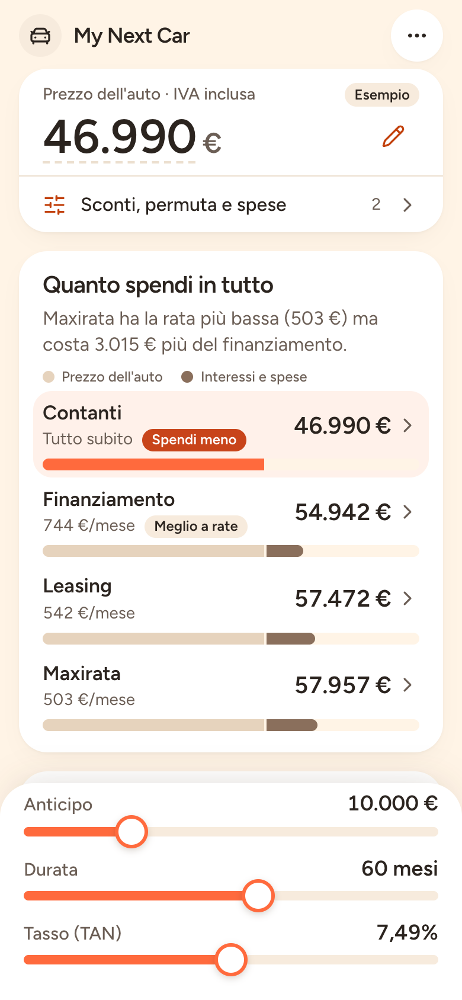
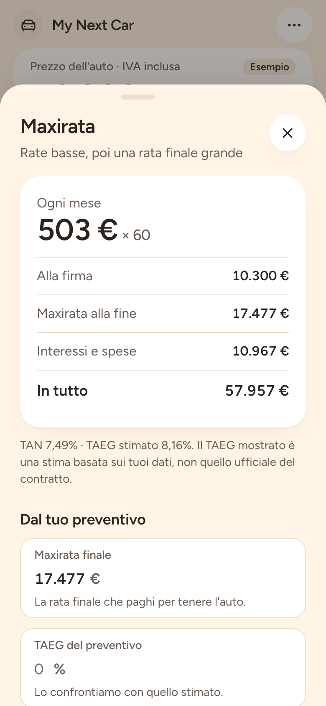
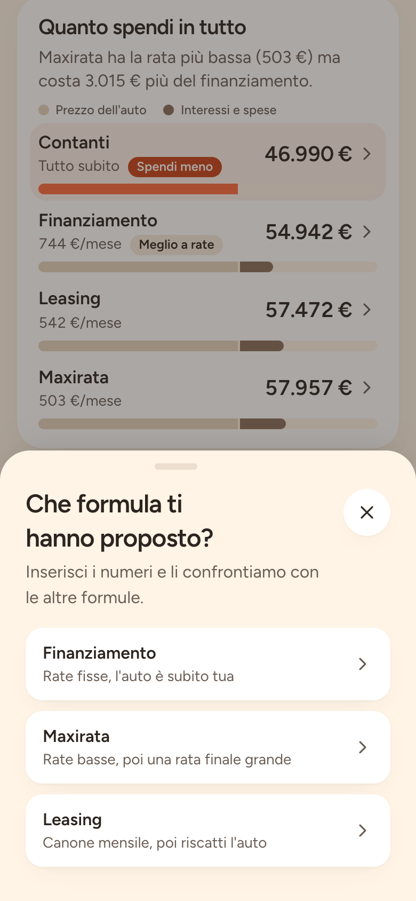
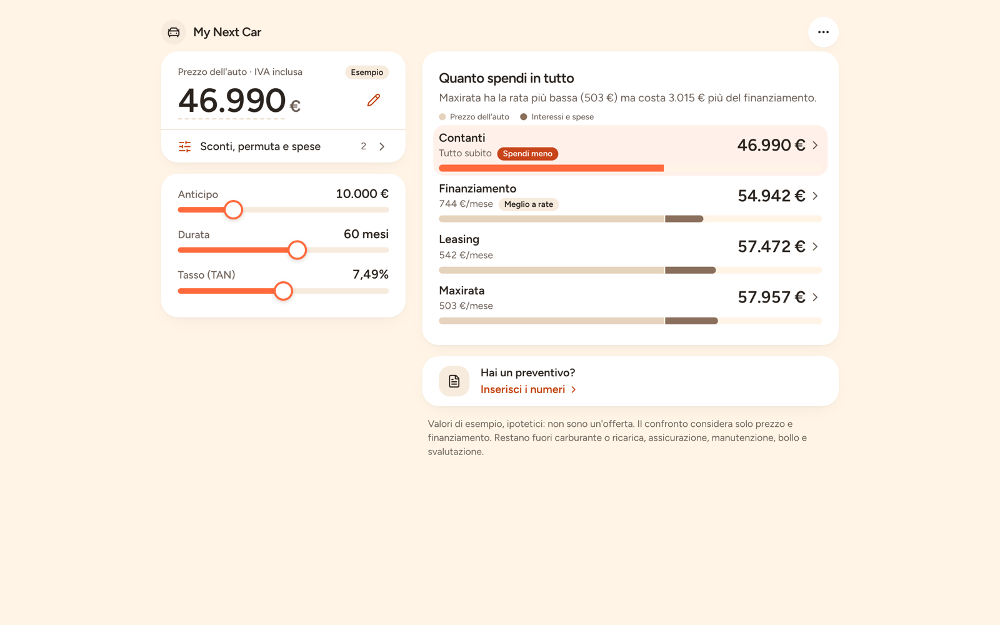

# My Next Car

How much will your next car really cost you? My Next Car compares four ways of paying for the same vehicle (cash, a traditional loan, a balloon loan with *maxirata*, and financial leasing) and shows what each one costs **in total**, not just per month.

It is a mobile-first single-page app for the Italian market. You type the price and move three sliders; everything else is optional. There is no backend: data stays in the browser.

<p>
  
  
  
</p>



## What it does

- **One number to type.** The vehicle price. Down payment, duration and rate (TAN) are sliders, docked under the thumb on phones.
- **Total cost first.** The four options are ranked by what you pay in total, on one fixed scale that separates the price of the car from interest and fees. Rows slide to their new rank as you move the sliders.
- **One sentence of advice.** The classic trap gets called out: a lower monthly payment that costs more overall.
- **Details on demand.** Tap an option to see monthly payment, cash at signing, final payment, interest and fees, and an estimated TAEG. If you have a dealer quote, enter balloon, buyout, quoted lease payment or quoted TAEG there.
- **Optional extras.** Discounts, incentives, trade-in and financing fees live in one sheet.
- **Share and export.** Native share sheet (or a copied link with the scenario in the URL), CSV export for Italian spreadsheets, reset.

## Getting started

Requires Node.js 22 or later.

```bash
npm install
npm run dev
```

| Command           | What it does                               |
| ----------------- | ------------------------------------------ |
| `npm run dev`     | Start the Vite dev server                  |
| `npm test`        | Run the Vitest suite                       |
| `npm run lint`    | Run oxlint                                 |
| `npm run build`   | Type-check and build for production        |
| `npm run preview` | Serve the production build locally         |

## How the code is organised

The rule is simple: **decisions live in plain functions with tests; components only render them.**

```
src/
  domain/
    financing/   The financial engine: amortization, rate solving, validation,
                 the comparison of the four methods. Integer cents throughout.
    scenario/    How user input changes a scenario (price, common terms).
    summary/     What the screen says about a comparison: ranking, the key
                 insight, the bar scale.
  lib/           Formatting, parsing, CSV, URL sharing, localStorage, and all
                 Italian copy in strings.ts.
  hooks/         useSimulation (state + derived result), useFlip (row animation).
  components/    Presentational React components, one per file.
  App.tsx        Composes the screen and decides which sheet is open.
```

Every module in `domain/` and `lib/` that makes a decision has a `*.test.ts` next to it. The engine tests compare integer cents exactly and rates within ±0.01.

## Deploying

`netlify.toml` is ready: build command `npm run build`, publish directory `dist`, Node 22, an SPA fallback and long-lived caching for hashed assets. Connect the repository to Netlify and it deploys as is. Any static host that serves `dist/` works too.

## Financial assumptions

- Italian market, amounts in EUR including VAT.
- Installments are paid monthly in arrears; the final payment (balloon or buyout) comes with the last one.
- Upfront fees are paid at signing and are not financed.
- Amounts are rounded to the cent and the last installment absorbs rounding.
- Leasing uses the same mathematics as a balloon loan.
- The TAEG shown is an estimate from the data entered, not the official contract TAEG.
- A trade-in worth less than its outstanding loan adds the difference to what you finance.

## Out of scope

Only purchase and financing costs are compared. Fuel or charging, insurance, maintenance, road tax, depreciation, resale value, opportunity cost and tax rules are not. The app never suggests real offers, rates or incentives: example values are hypothetical and labelled as such.

## Design

`PRODUCT.md` records who the product is for and what must stay true. `DESIGN.md` records the visual system (tokens, type, components, rules). `docs/original-brief.md` is the brief the first version was built from.

## License

MIT, see [LICENSE](LICENSE).
